# 全球电台 · Global Radio · DeepSeek Harness 插件

在 DeepSeek Harness 里直接收听全球实时电台。左侧栏入口 → 网易云风格的发现页（大 banner + 分类卡 + 横滑列表），
点分类卡会**随机挑一台该类型的电台**开始播放；**也可以在对话框直接说「播放上海的某个电台」「随便来点电台」「来点新闻电台」「听 FM 97.4」，Agent 会调用插件工具直接开播**；底部常驻大播放条随时控制；进入播放页看**物理频率（FM / AM）**、
台标与实时频谱；回到对话继续工作时播放器收进左侧栏，与网易云音乐的迷你条**上下堆叠**，同一时刻只有一条音频在发声。

- 国内电台：CNR / CRI / 凤凰 / 北京上海广东等省市级电台（含 FM 频率台）
- 国际电台：Radio Browser 收录的 6 万+ 电台，按国家 / 分类 / 热度浏览与搜索
- 支持直链 MP3/AAC 与 **HLS（m3u8）** 电台（内置 hls.js，播放列表与分片经 Host 代理重写，规避 CORS/相对路径）
- **备用信号源**：主源播放失败自动请求同名候选源并换源重试；仍失败则标记不可播、从列表过滤并自动跳下一台
- 与网易云音乐**自动互斥**：谁开始播，另一个自动暂停；两条迷你条垂直堆叠，不横向并排

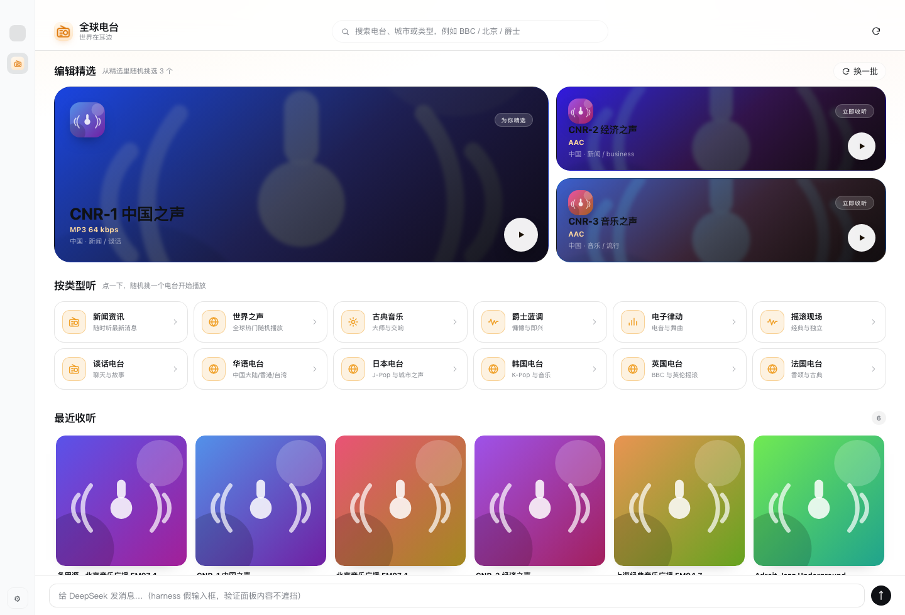

## 界面预览

| | |
| --- | --- |
|  | 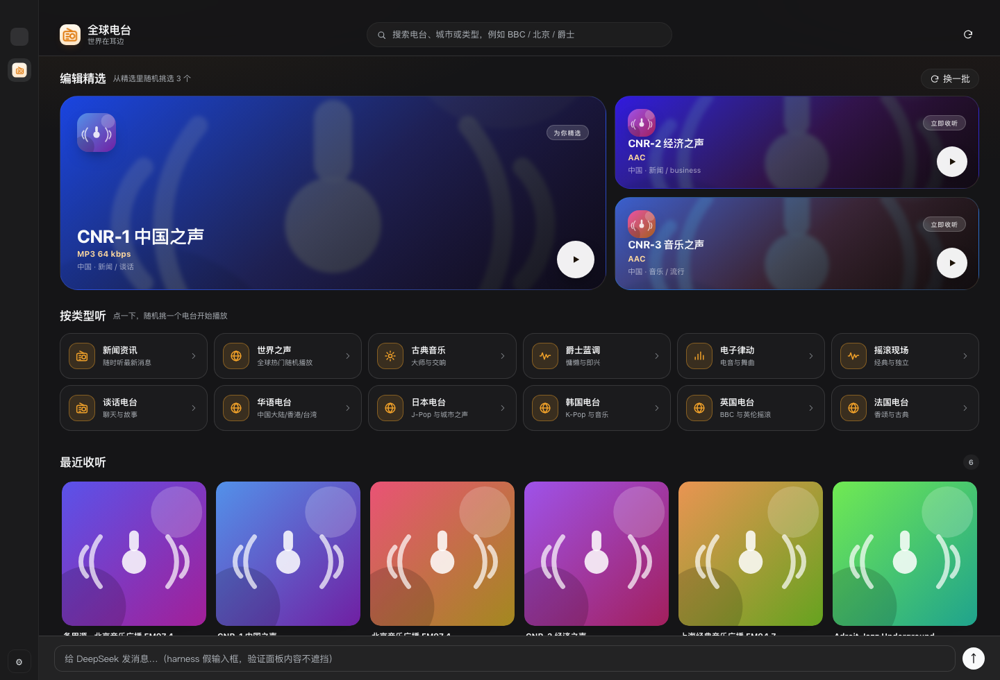 |
| 发现页：3 张大 banner + 12 个分类卡 + 自适应网格列表 | 深色主题 |
| 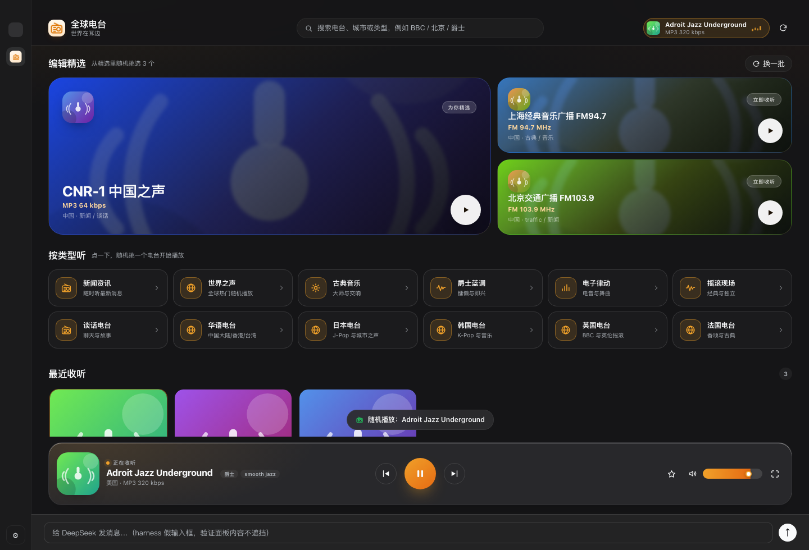 | 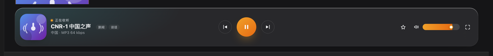 |
| 点分类卡随机挑一台播放，提示「随机播放：xxx」 | 底部常驻大播放条（控制居中对称） |
| 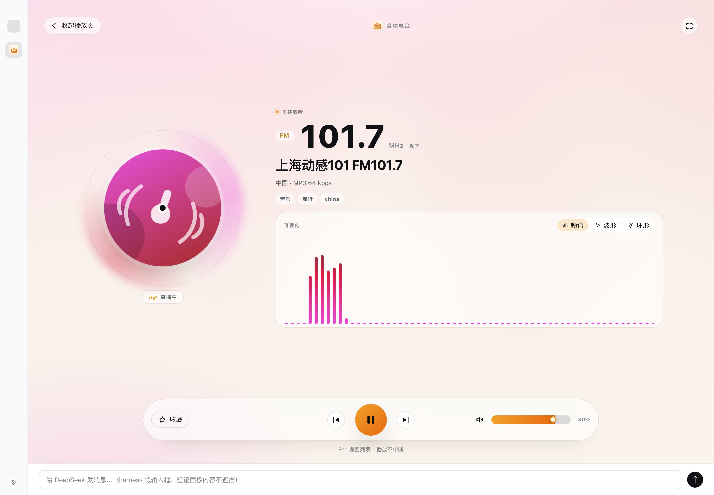 | 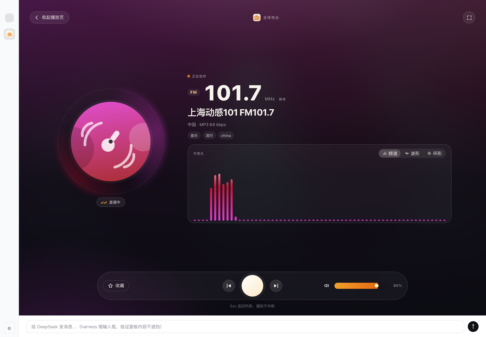 |
| 全屏播放页：跟随浅色主题（台标 / FM 频率 / 可视化） | 全屏播放页：深色主题 |
| 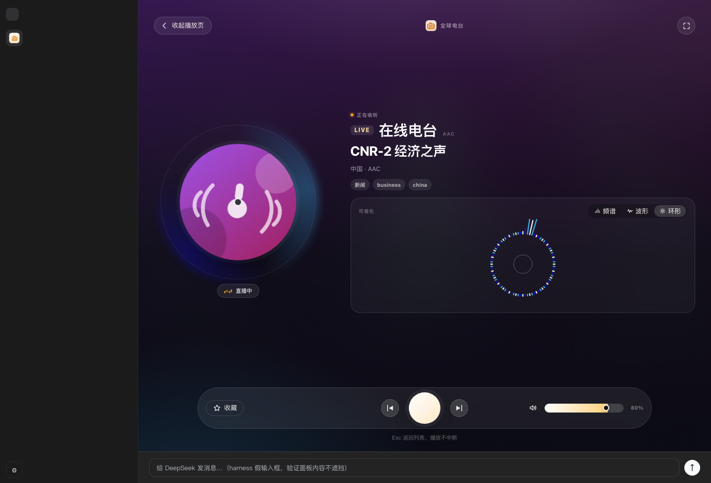 | 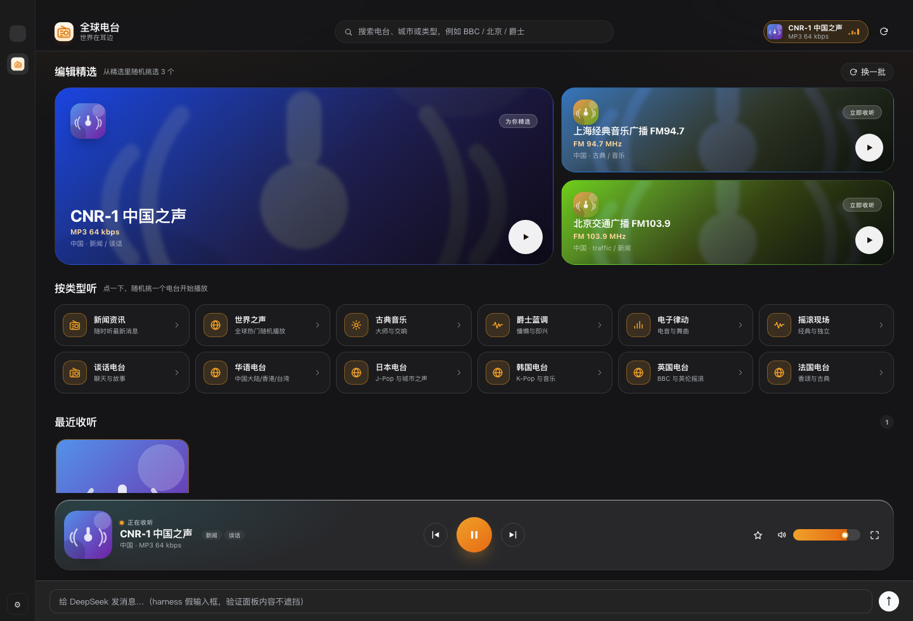 |
| HLS 电台播放 + 实时频谱 | 点 banner 直接播放 |
| 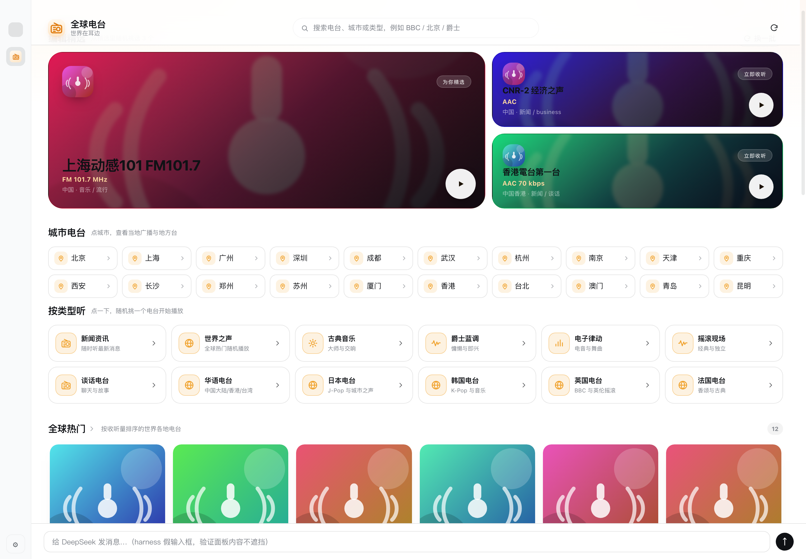 | 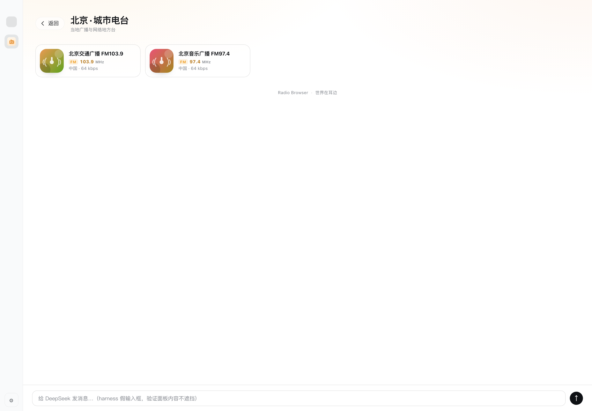 |
| 城市电台：20 个主要城市入口 | 点城市进入当地地方台集合页 |
| 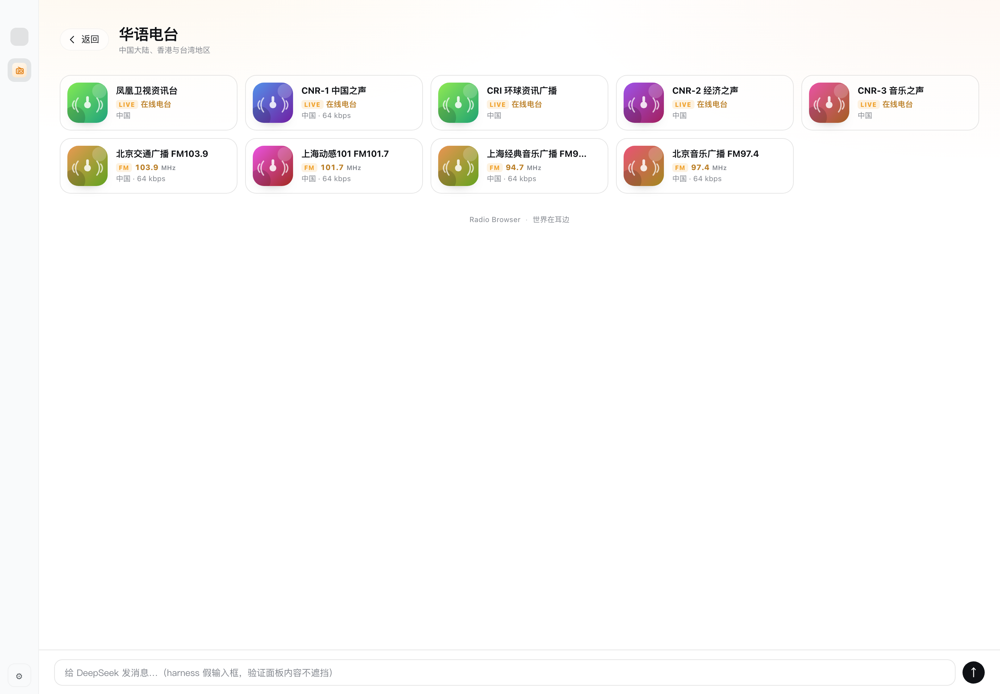 | 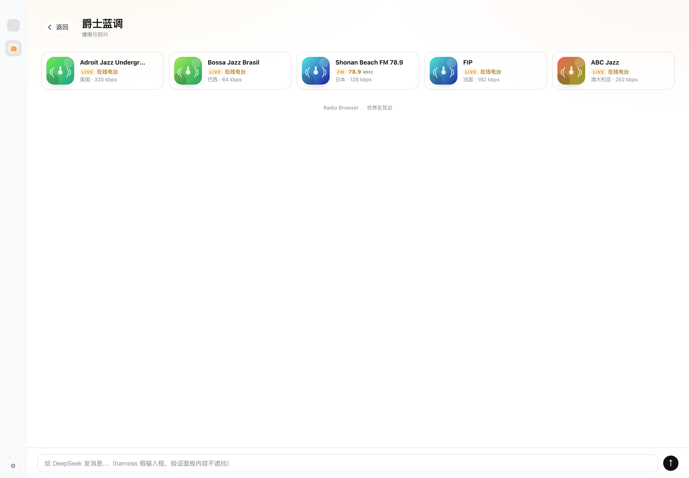 |
| 点「华语电台」标题进入集合页，可加载更多 | 点分类卡「›」查看该类型全部频道 |
| 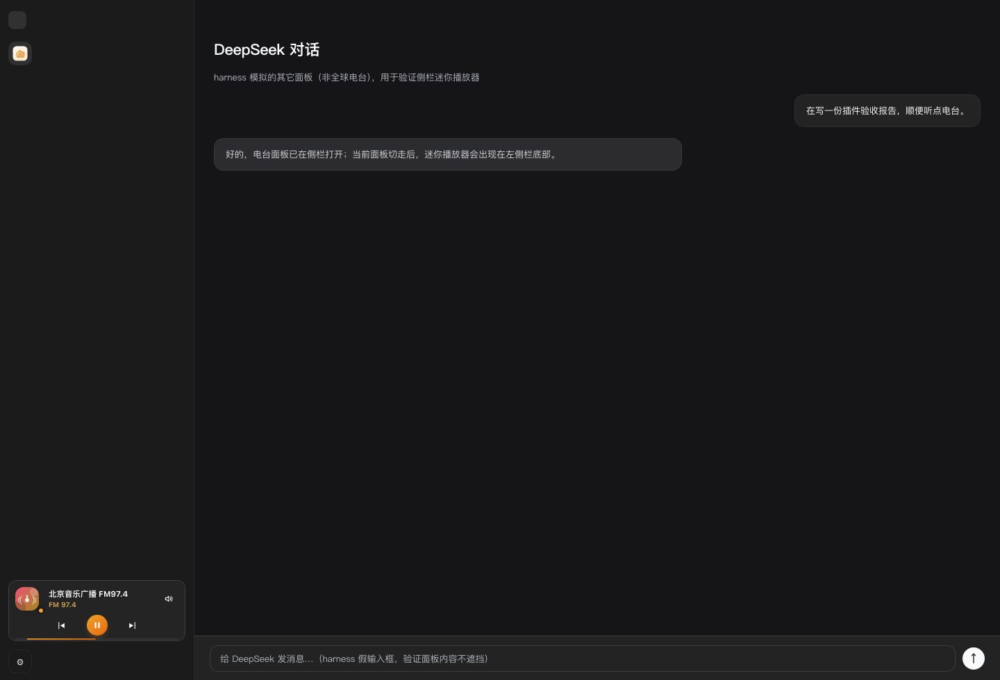 | 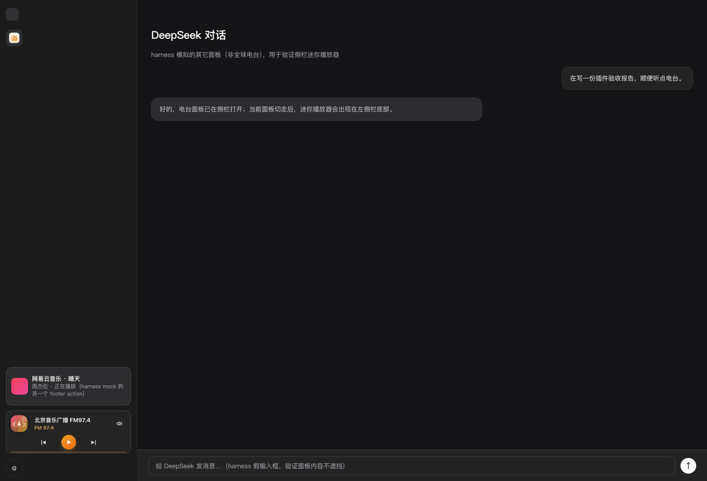 |
| 后台播放：左侧栏迷你条 | 与网易云迷你条上下堆叠（只一个发声） |
|  |  |
| 侧栏入口图标（与页面内小收音机同款） | 侧栏入口图标（浅色） |

## 功能

### 发现页（网易云风格）
- **大 banner × 3**：精选台大图 + 台标 + 台名 + 频率 + 国家/tags；**初始 3 个每天自动轮换**（日期做随机种子），右上角「**换一批**」还能立即随机换 3 个，不会看腻。
- **城市电台 × 20**：北京 / 上海 / 广州 / 深圳 / 成都 / 武汉 / 杭州 / 南京 / 天津 / 重庆 / 西安 / 长沙 / 郑州 / 苏州 / 厦门 / 香港 / 台北 / 澳门 / 青岛 / 昆明。**点城市 = 进入该城市的地方台集合页**，包含当地广播与网络地方台（如北京交通/音乐、上海动感101、广东音乐之声等）。
- **分类卡 × 12**：新闻资讯 / 世界之声 / 古典音乐 / 爵士蓝调 / 电子律动 / 摇滚现场 / 谈话电台 / 华语 / 日本 / 韩国 / 英国 / 法国。
  **点一下 = 随机挑一台该分类的电台开始播放**，只显示 toast「随机播放：xxx」，不打断浏览。
- **自适应网格列表**：全球热门 / 华语电台 / 编辑精选 / 最近收听 / 我的收藏；随窗口宽度自动 6/5/4/3/2 列换行，封面完整显示、不需要鼠标横向拖动。
- **点板块标题查看全部**：每个列表标题（如「华语电台」「全球热门」「编辑精选」）和每个分类卡右侧的「›」都可以进入**集合页**，显示该分类下的全部频道（36 条/页，可加载更多）；分类卡主体点一下仍是随机开播。
- **搜索**：顶栏搜索框按台名 / 城市 / 类型搜索；搜索结果替换发现页。

### 播放与频率
- 卡片/列表/播放页统一展示 **FM / AM 物理频率**（如 `FM 97.4 MHz`、`AM 720 kHz`）；网络台显示 `LIVE 在线电台` + 码率。
- 频率解析自台名（`FM97.4`、`调频 97.4`、`97.4 FM` 等）或精选数据指定；卡片的频率用 `FM 97.4 MHz` 三段式排版。
- **底部大播放条**（browse 视图常驻）：台标 + 台名 + 频率 + tags；中间 上一台/播放暂停/下一台 **居中对称**；右侧收藏、音量、展开播放页。占面板自己的布局行，不悬浮、不遮挡内容。

### 全屏播放页
- **跟随 DSH 主题**：浅色主题下是浅色磨砂播放页（深色文字、浅色控制条），深色主题下是深色沉浸播放页；切换主题即时生效（`body[data-ds-dark-theme]`）。
- 模糊台标背景 + 圆形旋转台标；**频率大字**（`FM`/`AM` + 数值 + `MHz`/`kHz`）；国家 · codec · bitrate · tags。
- **实时可视化**：Web Audio `AnalyserNode` + canvas，三种模式可切换并 localStorage 记住：频谱柱 / 波形 / 环形。
- 底部玻璃控制条：收藏 + 上一台/播放暂停/下一台（居中）+ 音量；右上角浏览器全屏；Esc 返回不中断播放。

### 后台播放 & 侧栏迷你条
- 离开电台面板后继续播放，左侧栏出现迷你条：台标 + 台名 + 频率 + 上一台/播放/下一台 + 音量（hover 弹层）+ 底部电平条。
- 侧栏收起时只留圆形台标按钮 + 播放脉冲环。
- **与网易云迷你条上下堆叠**：强制独占整行，绝不左右并排；被对方暂停时自己的迷你条保留（点一下抢回播放）。
- 不悬浮、不遮挡输入框。

### 音频互斥（与网易云音乐）
- 电台开始播 → 暂停页面上其它 `<audio>/<video>`；其它播放器开始播 → 电台自动暂停。
- 只调 `pause()`，不改对方 `src`/`volume`；不修改网易云插件源码。双向生效。
- `MediaSession` 同步当前电台元数据。

### 备用信号源 / 不可播过滤（避免“点了没声音”）
- 主源播放失败（audio error、HLS fatal、9 秒内没进入 `playing`）→ 请求 Host `/alternates`，按台名/国家找候选流并做健康检查，最多 3 个逐个换源重试，toast「已切换到备用源：xxx」。
- 全部失败 → 标记 `unavailableIds`，从所有列表/随机池中过滤；toast「暂时无法播放」并自动跳到队列下一台（一次，避免循环）。
- Host `/check` 可预检流地址（含跟随重定向后识别 m3u8），`/stream` 代理不再请求 `Icy-MetaData`（Chrome 无法解码夹带 ICY 元数据的 MP3 流，这会导致直链电台“没有声音”）。

## 在对话里直接点播（Agent 工具）

装好插件后，不需要点界面，直接对 DeepSeek 说：

- 「**播放上海的某个电台**」→ `radio_play({ query: "上海" })`
- 「**来点音乐电台 / 新闻电台 / 古典电台**」→ `radio_play({ genre: "music" / "news" / "classical" })`
- 「**随便来点电台**」→ `radio_play({ random: true })`
- 「**听 FM 97.4 / 放 BBC**」→ `radio_play({ query: "FM 97.4" / "BBC" })`
- 「**暂停 / 继续 / 下一台 / 调小音量 / 现在放的是什么**」→ `radio_player({ action: ... })`
- 「**先搜一下有哪些北京电台**」→ `radio_player({ action: "search", query: "北京" })`

工具由 Host 注册并自动注入 systemPrompt：用户提到**电台 / 广播 / FM / AM / 收音机 / 网络电台**时使用 `radio_play` / `radio_player`，**不要用网易云音乐工具**；反过来，用户要听歌/歌曲/歌单时才用网易云工具。播放后电台在插件播放器里出声，面板内显示底部大播放条，回到对话后收进左侧栏迷你播放器，不打断对话。

> 原理：Host 把工具解析出的电台放入命令队列，浏览器端每 1.2s 轮询执行并回报状态；详见 `docs/CONTRACT.md` §2.7b / §4.6。

## 数据来源

| 来源 | 用途 | 说明 |
| --- | --- | --- |
| [Radio Browser](https://www.radio-browser.info/) | 全球电台目录 | 社区维护、无需 key；Host 侧镜像探测、TTL 缓存、字段归一化 |
| `data/seed-stations.json` | 编辑精选 + 离线兜底 | 49 条人工挑选、实测可播（含 7 条 FM 频率、18 条 HLS） |
| `data/SOURCES.md` | 数据源验证报告 | 镜像可用性、DNS 污染清单、HLS 结构、代理注意事项 |

上游不可用时首页自动回退精选台单。Host 只使用 `url_resolved` 并过滤 `.pls/.m3u` 播放列表文件。

## 架构

```
dsh-global-radio/
├── index.js                 # Host：路由、Radio Browser 代理、流代理、HLS 重写、健康检查、备用源、图片缓存、Agent 工具
├── client.js                # 浏览器：3 个 slot、发现页、播放页、可视化、底部大播放条、迷你条、音频仲裁、失败换源
├── locale/{zh,en}.json      # 插件管理页标题/描述
├── assets/icon*.png         # 品牌图标（64/128/256）
├── vendor/hls.light.min.js  # 内置 hls.js（Apache-2.0）
├── data/seed-stations.json  # 精选台单（49 条）
├── data/SOURCES.md          # 数据源调研
├── docs/CONTRACT.md         # Host/Client/验收契约
├── docs/screenshot-*.png    # 验收截图
└── selftest/                # headless Chrome 离线验收工程
```

### Host 路由（`/global-radio/api`）

| 路由 | 作用 |
| --- | --- |
| `GET /status` | 服务/上游/精选数/HLS 运行时状态 |
| `GET /home` | 首屏：精选 + 全球热门 + 华语电台 + 国家/分类（TTL 10min） |
| `GET /search?q=&country=&tag=&offset=&limit=` | 搜索与筛选（2min 缓存） |
| `GET /check?url=` | 快速检查流：是否 HLS / 是否可解码音频 |
| `GET /player/commands?cursor=` | Agent 工具命令队列（浏览器轮询执行） |
| `POST /player/state` | 浏览器上报当前播放状态（供工具确认/查询） |
| `GET /alternates?id=&name=&country=&url=` | 备用源候选（同名/同国 + 健康检查，最多 3 个） |
| `GET /stream?url=&id=` | 音频流代理（同源、流式、不转发 Range、不带 Icy-MetaData） |
| `GET /hls?url=` | HLS 播放列表重写（master/media 的 URI、KEY/MAP/MEDIA）+ 分片代理 |
| `GET /img?url=` | 台标图片代理 + LRU 缓存 |
| `GET /icon?size=64\|128\|256` | 插件图标 |
| `GET /hls-runtime.js` | 按需提供内置 hls.js |

### Client slots

| slot | id / key | 作用 |
| --- | --- | --- |
| `main` | `global-radio` | 整页电台面板（发现页 / 播放页） |
| `sidebar.panellist` | `global-radio`（order 40） | 左侧栏入口图标（内联矢量，与页面小收音机同款） |
| `sidebar.footer.action` | `radio-mini`（order 20） | 后台播放迷你条（与网易云迷你条上下堆叠） |

## 安装

在 DeepSeek Harness 中：

```text
plugin_manager action=install_bundle target=<你克隆到的路径>/dsh-global-radio
```

或：

```bash
git clone https://github.com/zeelinkCN/dsh-global-radio.git
```

然后在 Harness 里用 `plugin_manager` 指向该目录安装。安装后左侧栏出现「全球电台」图标；
无需命令行、无需账号、无需 Python/额外依赖（hls.js 已随包内置）。修改/升级后刷新 Harness 页面（Cmd+R / Ctrl+R）即可加载新 client bundle。

### macOS / Windows

插件本身是「纯 Web（React + canvas + Web Audio）+ Node Host（node:http / fetch）」实现：

- 无平台相关命令、无原生模块、无 Python 引擎；路径全部用 `node:path` / `fileURLToPath`。
- 音频/HLS/图片代理都是跨平台 HTTP 路由；hls.js 随包提供。
- 已在 macOS（Harness Desktop）完成开发与验收；Windows 使用同一份文件，推荐用 Harness Desktop 的 `plugin_manager` 安装，
  如遇路径问题请提 issue。

## 使用

1. 点左侧栏「全球电台」图标。
2. 发现页：点大 banner 直接听；点「换一批」随机换 3 个精选（每天还会自动换）；点**城市电台**里的城市查看当地地方台；点分类卡主体随机开播，点分类卡右侧「›」查看该类型全部频道；点板块标题（如「华语电台」）进入集合页并加载更多。
3. 底部大播放条随即出现：暂停/继续、上一台/下一台、音量、收藏、展开播放页。
4. 播放页里切频谱/波形/环形、浏览器全屏、Esc 返回。
5. 切回对话：播放不中断，左侧栏底部出现迷你条；开始播网易云音乐时电台自动暂停，反之亦然。
6. 若某个台源失效，会自动换备用源；仍不行会提示并跳过，不再出现“点了没声音”。

## 配置

Host 侧无需配置。

## 验收与测试

- 契约：`docs/CONTRACT.md`（Host API、Station 形状、UI、互斥、备用源、测试钩子）。
- 离线 UI 验收（headless Chrome + 真实 `client.js` + mock Host）：`cd selftest && node run.mjs`
  - 覆盖 slot 注册、发现页 banner/分类/横滑列表、分类随机播放、底部大播放条、播放页三模式可视化、
    迷你条宽/窄两态与网易云堆叠、双向互斥、备用源切换/不可播过滤、错误态重试、深浅色与 1440/1024/600 响应式、无 console.error。
- 数据源实测：`data/SOURCES.md`（49/49 种子可播；HLS 分片 200）。
- 真实音频回归：host `/stream` 代理实测 BBC / qtfm / CNR-1 等直链在 Chrome 内 `currentTime` 前进；HLS 实测 CNR 播放列表重写 + MPEG-TS 分片。
- Agent 工具联调：在真实 Harness 对话里调用 `radio_play({query:"上海"})` → 客户端播放并回报状态；`radio_player(status/pause/resume/search)` 均正常。

## 已知局限

- Radio Browser 在本机网络下仅 `de1/de2` 可用；Host 会按 de1→de2→all→at1→nl1 探测并降级精选。
- 少量境外流受 DNS/地区限制不可达；已用备用源 + 不可播过滤兜底。
- 不支持节目单（EPG）、录音、回听；HLS 仅音频播放。
- 电台与网易云音量各自记忆；切换播放不互改音量。
- 迷你条位置由 Harness 的 `sidebar.footer.action` 决定；宿主改版时可能随之变化（已用 `:has()` 适配当前版本）。

## 许可

- 插件代码 MIT（见 `LICENSE`）。
- 内置 `vendor/hls.light.min.js` 为 [hls.js](https://github.com/video-dev/hls.js) Apache-2.0，许可证见 `vendor/LICENSE-hls.js`。
- 图标为原创（浅橙圆角底 + 页面内同款小收音机线条）。
